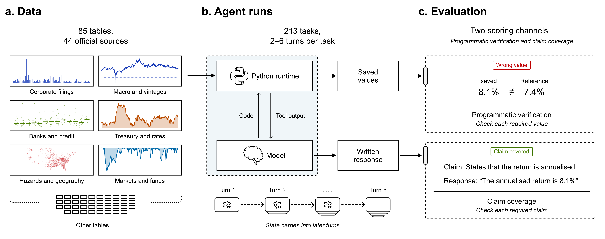
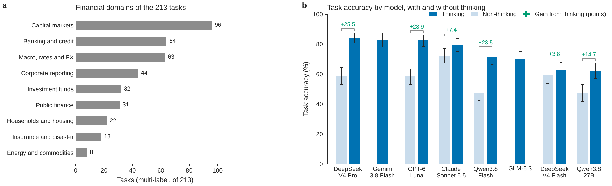

# FinAgenticBench

**Errors shared by language model agents are harder to detect and correct**

[Paper](#citation) (link to be added) · [Data and runs](#data-and-run-artifacts) · [Reproducing the paper](#reproducing-the-paper)

FinAgenticBench is a benchmark of 213 multi-turn financial analysis tasks over 85 tables from 44 official data
sources, with programmatically verified outputs. An agent writes and runs Python against tables from SEC, FFIEC,
Treasury, Federal Reserve, FEMA, BIS and other public sources (data up to 31 December 2025). Each turn asks for
named output variables whose unit, precision and representation are fixed in their descriptions; when the turn
ends, a deterministic validator compares every stored output with a value recomputed from the same tables. Prose
is never parsed for numbers.

Because every answer is a checked value, the runs also show whether two agents computed the same wrong number,
which reading of the data produced it, and whether the usual checks (a second run, a second model, a reviewing
model) catch it.



*(a) The 85 tables from 44 official sources, in six groups. (b) Each task runs over two to six turns, and state
carries into later turns; in each turn the model writes code that a Python runtime executes on the task's tables,
and the turn ends with saved values and a written response. (c) Saved values are checked against a reference
recomputed from the same data; the written response is checked against the claims written with the task. The example is
illustrative.*

## The benchmark

Each task follows an analyst through a real question: find a population or an instrument in official data, join it
to other sources, apply the conventions those sources follow, and carry the result through two to six turns to a
figure or a decision. The first turn establishes a state (a cohort of filers, a security, a data vintage) and each
later turn uses it for a new computation.

| | |
|---|---|
| Tasks | 213 (212 join two or more sources) |
| Turns | 858, two to six per task (four on average) |
| Scored outputs | 3,845 output variables across all turns |
| Data | 85 runtime tables from 44 official sources, cut off at 2025-12-31 |
| Task families | retrieval, calculation and reconciliation, comparison and ranking, temporal path and vintage, risk screening, scenario analysis |
| Financial domains | corporate reporting, banking and credit, investment funds, capital markets, macro/rates/FX/trade, public finance, households and housing, insurance and disaster, energy and commodities |
| Agent interface | one `python` tool in a persistent kernel, 30 calls per turn; only the task's declared tables are visible |
| Scoring | programmatic verification (primary); claim coverage and response quality by language-model judges |

A task passes only when every output in every turn is correct. The reference value of every output was
recomputed twice, independently, before the task entered the benchmark. The full task list is in
[`docs/benchmark_catalog.md`](docs/benchmark_catalog.md).

## Main results

We evaluated eight models, six of them both with and without a reasoning mode ("thinking"), giving fourteen
configurations. Each configuration attempted every task three times, 8,946 runs in total.



*(a) Financial domains of the 213 tasks (a task can belong to several). (b) Task accuracy of each model with and
without thinking; mean of three runs, 95% task-resampled bootstrap intervals, gain from thinking in percentage
points.*

| Model | Non-thinking (%) | Thinking (%) | Gain (pp) |
|---|---:|---:|---:|
| DeepSeek V4 Pro | 58.7 | **84.2** | +25.5 |
| Gemini 3.8 Flash | — | 82.8 | — |
| GPT-6 Luna | 58.5 | 82.5 | +23.9 |
| Claude Sonnet 5.5 | 72.3 | 79.7 | +7.4 |
| Qwen3.8 Flash | 47.7 | 71.2 | +23.5 |
| GLM-5.3 | — | 70.3 | — |
| DeepSeek V4 Flash | 59.2 | 62.9 | +3.8 |
| Qwen3.8-27B | 47.4 | 62.1 | +14.7 |

*Task accuracy: share of the 213 tasks with every turn correct, mean of three runs. Gemini 3.8 Flash and GLM-5.3
cannot switch thinking off. The four leading configurations did not differ from one another (paired 95% intervals included zero). Below, the
strong tier is the configurations at 78% or above and the weak tier those below 60%.*

**Agents give the same wrong values.** If each configuration erred independently at its own rate on each task,
1,433 of the 3,669 outputs attempted by all fourteen would have escaped every error and 364 would have been failed by
six or more configurations; 1,902 and 529 did. Of all wrong values, 39% were a value that at least three of the
fourteen configurations gave on the same output (we call these shared, and the rest unshared). Which output is asked
for explains 27.8% of the variance in correctness, which configuration answers it 2.4%. Apart from the two modes of
one model, shared wrong values show no detectable clustering by vendor.

**Agreement passes the errors agents share.** Among thinking configurations, a second run of the same model
repeated 49.4% of the wrong values that at least two configurations of other vendors also gave, and 10.3% of the
rest; one run of another vendor's model repeated 25.3% and 4.7%. Agreement is still a good sign for a single
output: two runs of one model that agreed were correct 98.3% of the time and one run each from two vendors 99.2%.
But of the wrong values two vendors agreed on, 79% were also given by configurations of other vendors. On 111
air-quality tasks, a second run likewise repeated shared wrong values more often than the rest (53.7% against 27.4%).

**Verifiers keep the shared errors they are shown.** Three verifiers were shown the stored values of another
configuration's run on 149 tasks and asked to recompute each from the data. They corrected 73.5% of the unshared
wrong outputs and 38.4% of the shared ones. On the shared ones, a verifier stored the correct value less often when
shown the wrong one than in its own independent runs (38.4% against 50.5%, a difference of −12.0 points, 95% CI
−24.1 to −2.7).

**Shared errors lie in conventions and in the meaning of data rows.** We read the code behind the 307 outputs on
which five or more configurations gave the same wrong value. The two largest sources were statistical conventions
(23.7% of these wrong attempts), mostly stated in the task, and data-model semantics (22.2%): a filer is its SEC
identifier (CIK) and not its name, a file carries a total row beside the detail rows. Two readers judged, for the
72 root causes that admit a second reading, which reading the task's wording requires; each chose the reference in
69, and on no item did both choose the shared reading. Rewording four tasks removed the shared readings it targeted
and raised passes from 80 to 122 of 168 runs.

**Shared errors fall more slowly with accuracy.** From the weak to the strong tier, unshared wrong values fall by
88% and shared ones by 47%, and 65% of strong-tier wrong values are shared. Where a strong and a weak configuration
both erred on an output, the strong one gave the other configurations' most common wrong value 52% of the time and
the weak one 37%. The relation was measured between 47% and 84% task accuracy; GPT-6.1 Sol, run afterwards with its
expected share recorded beforehand, reached 96.4% and fell below the predicted interval.

**Judging the written response says little about whether the numbers are right.** Three judges from different
vendors checked each turn's response against its claims, without the reference values. Claim coverage separated
correct from incorrect turns with an AUC of 0.52–0.53, also without each judge's own vendor. Judges shown the
reference outputs and scoring response quality reached 0.87 and 0.85.

Because every output is checked by a program, the tasks could also provide verifiable rewards for reinforcement
learning (RLVR); the paper discusses this use but does not test it.

## Installation

Python 3.12 and [uv](https://docs.astral.sh/uv/) are required.

```bash
uv sync --group dev
uv run --group dev python -m pytest -m "not runtime_data and not raw_data"   # runs without the data
```

## Data and run artifacts

Two archives are distributed separately on Google Drive; download them and unzip both at the repository root.

| Archive | Unzips to | Contents |
|---|---|---|
| [`FinAgenticBench-data.zip`](https://drive.google.com/file/d/1oXdaz0lpf24xoBBAWhdlyTnasH2FUC2C/view?usp=drive_link) (1.2 GB) | `datasets/dataset_new/` | the runtime tables the tasks read, with `catalog.json`, per-source `schema.json` and `sources.json`; three sources whose terms do not allow redistribution are rebuilt from the publishers instead (see below) |
| [`FinAgenticBench-runs.zip`](https://drive.google.com/file/d/1pT193gRyY6eUVtKgGAv9CH6limrxHtvu/view?usp=drive_link) (546 MB) | `experiments/`, `analysis/final_20261012/inputs/` | the paper's 8,946 runs with transcripts and scores, and one pre-revision input of the analysis |

With the data in place, check the installation and run the full test suite:

```bash
uv run python -m scripts.ingest.build.build_dataset_layers --check
uv run --group dev python -m pytest
```

[`docs/data_release.md`](docs/data_release.md) describes the data artifact, its provenance and licences, and the
rebuild-from-source path under `scripts/ingest/`. The tables of `finra_short_volume`, `ken_french` and `rtdsm`
(read by 27 tasks) are not in the archive because their publishers' terms do not grant redistribution; the
document gives the three commands that rebuild each from its publisher. Until then the check reports them as not
installed and the tests that read them are skipped.

## Running a model

Copy `models.toml.example` to `models.toml` and fill in the endpoints and keys (the file is ignored by Git). The
tested model and each judge, whether the default panel or those named with `--judge`, need a section there.
Then:

```bash
uv run python -m scripts.run --experiment <study> --model <model-id> --concurrency 10
uv run python -m scripts.score_programmatic_verification --experiment <study>
uv run python -m scripts.score_claim_coverage --experiment <study> --judge <judge-id> --concurrency 4
uv run python -m scripts.run_stats --experiment <study>
```

Each run is written to `experiments/<study>/runs/<task>/<model>/<run_id>/`; the layout and the judges used in the
paper are described in [`experiments/README.md`](experiments/README.md). Scoring is described in
[`docs/scoring_design.md`](docs/scoring_design.md).

## Reproducing the paper

[`analysis/README.md`](analysis/README.md) lists the scripts, in order, that rebuild every table and log behind the
paper's figures and numbers from the run archive.

## Repository layout

```text
benchmarks.json   the task registry (213 tasks)
evals/            tasks: <family>/<task>.json (turns, queries, claims) and <task>.py (outputs, recomputation, validator)
core/             runtime, data access, agent harness, validation, scoring and the result layout (see core/README.md)
scripts/          every command: running, scoring, reports, catalog generation and data acquisition (see scripts/README.md)
metadata/         task taxonomy, capability labels, data licences and temporal coverage
prompts/          judge prompts
criteria.json     response-quality rubric
docs/             data release, scoring design, the generated task catalog and capability coverage
experiments/      run artifacts, unzipped from FinAgenticBench-runs.zip (see experiments/README.md)
analysis/         scripts, tables and logs that reproduce the paper (see analysis/README.md)
tests/            the test suite (see tests/README.md)
assets/           the figures used in this README
config.py         repository paths
models.toml.example   template for model and judge endpoints
```

## Citation

If you use FinAgenticBench, please cite the paper (citation to be added on publication).

## Contact

Questions and problems are welcome as GitHub issues.

## License

The code is released under the [MIT License](LICENSE). The data artifact carries the terms of its sources; see
[`docs/data_release.md`](docs/data_release.md).
