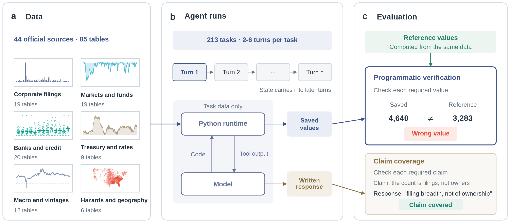

# FinAgenticBench

**Convergent errors in language model agents for financial analysis**

[Paper](#citation) (link to be added) · [Data and runs](#data-and-run-artifacts) · [Reproducing the paper](#reproducing-the-paper)

FinAgenticBench is a benchmark of 213 multi-turn financial analysis tasks over 85 tables from 44 official data
sources, with programmatically verified outputs. An agent writes and runs Python against tables from SEC, FFIEC,
Treasury, Federal Reserve, FEMA, BIS and other public sources (data up to 31 December 2025). Each turn asks for
named output variables whose unit, precision and representation are fixed in their descriptions; when the turn
ends, a deterministic validator compares every stored output with a value recomputed from the same tables. Prose
is never parsed for numbers.

Because every answer is a checked value, the runs also show whether two agents computed the same wrong number,
which reading of the data produced it, and whether a model's wrong answer changes when it reasons longer.



*(a) The 85 tables from 44 official sources, in six groups. (b) Each task runs over several turns; in each turn the
model writes code that a Python runtime executes on the task's tables, and the turn ends with saved values and a
written response. (c) Programmatic verification compares each saved value with a reference recomputed from the same
data; claim coverage checks the response against pre-registered claims.*

## The benchmark

Each task follows an analyst through a real question: find a population or an instrument in official data, join it
to other sources, apply the conventions those sources follow, and carry the result through two to six turns to a
figure or a decision. The first turn establishes a state (a cohort of filers, a security, a data vintage) and each
later turn uses it for a new computation.

| | |
|---|---|
| Tasks | 213 (212 join two or more sources; 188 run four or more turns) |
| Scored outputs | 3,845 output variables across all turns |
| Data | 85 runtime tables from 44 official sources, cut off at 2025-12-31 |
| Task families | retrieval, calculation and reconciliation, comparison and ranking, temporal path and vintage, risk screening, scenario analysis |
| Financial domains | corporate reporting, banking and credit, investment funds, capital markets, macro/rates/FX/trade, public finance, households and housing, insurance and disaster, energy and commodities |
| Agent interface | one `python` tool in a persistent kernel, 30 calls per turn; only the task's declared tables are visible |
| Scoring | programmatic verification (primary); claim coverage and response quality by language-model judges |

A task passes only when every output in every turn is correct. The reference value of every output was
recomputed twice, independently, before the task entered the benchmark. The full task list is in
[`docs/benchmark_catalog.md`](docs/benchmark_catalog.md).

## Main results

We evaluated eight models, six of them both with and without a reasoning mode ("thinking"), giving fourteen
configurations. Each configuration attempted every task three times, 8,946 runs in total.

| Model | Non-thinking (%) | Thinking (%) | Gain (pp) |
|---|---:|---:|---:|
| DeepSeek V4 Pro | 59.2 | **84.0** | +24.9 |
| Gemini 3.8 Flash | — | 83.3 | — |
| GPT-6 Luna | 58.8 | 82.2 | +23.3 |
| Claude Sonnet 5.5 | 72.1 | 79.8 | +7.7 |
| Qwen3.8 Flash | 47.6 | 70.9 | +23.3 |
| GLM-5.3 | — | 70.1 | — |
| DeepSeek V4 Flash | 58.8 | 62.8 | +3.9 |
| Qwen3.8-27B | 47.9 | 62.3 | +14.4 |

*Task accuracy: share of the 213 tasks with every turn correct, mean of three runs. Gemini 3.8 Flash and GLM-5.3
cannot switch thinking off. The four leading configurations are statistically indistinguishable. Below, the
strong tier is the configurations at 78% or above and the weak tier those below 60%.*

**Errors are shared across models.** Of all wrong values, 39% were a value that at least three of the fourteen
configurations gave (we call these shared, and the rest other); among the four most accurate configurations the
share was 65%. Which output is asked for predicts correctness much better than which model answers it: the
output explains 27.8% of the variance in correctness, the configuration 2.4%.

**Shared errors come more from reading the data than from missing financial knowledge.** We read the code behind
the 307 outputs on which five or more configurations gave the same wrong value. The two largest causes were
statistical conventions (23.8% of these wrong attempts: sample versus regression standard deviation, log versus
simple return, which end of a window is included) and the meaning of data fields (22.1%: a filer versus its
holding rows, a published total row beside the detail rows, a first-reported versus a latest value). Accounting
standards, market calendars and contract mechanics together accounted for 19.6%.

**Stronger models and thinking remove shared errors more slowly than other errors.** From the weak to the strong
tier, the other wrong values fall by 88% and the shared ones by 46%; with thinking, by 62% and 23%. When both
modes of a model were wrong on the same output, the thinking mode's value matched the other models' most common
wrong value more often, in each of the six paired models (by 7 points pooled).

**Agreement across vendors is a better check than agreement within one model.** Among thinking configurations,
two runs of one model that agreed on a value were correct 98.3% of the time, one run each from two vendors 99.2%,
and from three vendors 99.7%. A strong model that is wrong tends to give the same wrong value on every run, so its
runs agree with each other even when they are wrong.

**Judging the written response says little about whether the numbers are right.** Three judges from different
vendors checked each turn's response against its pre-registered claims, without seeing the reference values. Claim
coverage separated correct from incorrect turns with an AUC of 0.52–0.53, close to chance, and under every judge
the least accurate configuration covered the claims on more of its turns than the most accurate.

In short, higher accuracy alone does not make agent errors independent. Because every output is checked by a
program, the tasks could also provide verifiable rewards for reinforcement learning (RLVR); the paper discusses
this use but does not test it.

## Installation

Python 3.12 and [uv](https://docs.astral.sh/uv/) are required.

```bash
uv sync --group dev
uv run --group dev python -m pytest -m "not runtime_data and not raw_data"   # runs without the data
```

## Data and run artifacts

Two archives are distributed separately on Google Drive; download them and unzip both at the repository root.

| Archive | Unzips to | Contents |
|---|---|---|
| [`FinAgenticBench-data.zip`](https://drive.google.com/file/d/1oXdaz0lpf24xoBBAWhdlyTnasH2FUC2C/view?usp=drive_link) (1.3 GB) | `datasets/dataset_new/` | the runtime tables the tasks read, with `catalog.json`, per-source `schema.json` and `sources.json` |
| [`FinAgenticBench-runs.zip`](https://drive.google.com/file/d/1pT193gRyY6eUVtKgGAv9CH6limrxHtvu/view?usp=drive_link) (546 MB) | `experiments/`, `analysis/final_20261012/inputs/` | the paper's 8,946 runs with transcripts and scores, and one pre-revision input of the analysis |

With the data in place, check the installation and run the full test suite:

```bash
uv run python -m scripts.ingest.build.build_dataset_layers --check
uv run --group dev python -m pytest
```

[`docs/data_release.md`](docs/data_release.md) describes the data artifact, its provenance and licences, and the
rebuild-from-source path under `scripts/ingest/`.

## Running a model

Copy `models.toml.example` to `models.toml` and fill in the endpoints and keys (the file is ignored by Git). The
tested model and each judge, whether the default panel or those named with `--judge`, need a section there.
Then:

```bash
uv run python -m scripts.run --experiment <study> --model <model-id> --concurrency 10
uv run python -m scripts.score_programmatic_verification --experiment <study>
uv run python -m scripts.score_claim_coverage --experiment <study> --judge <judge-id> --concurrency 4
uv run python -m scripts.run_stats --experiment <study>
```

Each run is written to `experiments/<study>/runs/<task>/<model>/<run_id>/`; the layout and the judges used in the
paper are described in [`experiments/README.md`](experiments/README.md). Scoring is described in
[`docs/scoring_design.md`](docs/scoring_design.md).

## Reproducing the paper

[`analysis/README.md`](analysis/README.md) lists the scripts, in order, that rebuild every table and log behind the
paper's figures and numbers from the run archive.

## Repository layout

```text
benchmarks.json   the task registry (213 tasks)
evals/            tasks: <family>/<task>.json (turns, queries, claims) and <task>.py (outputs, recomputation, validator)
core/             runtime, data access, agent harness, validation, scoring and the result layout (see core/README.md)
scripts/          every command: running, scoring, reports, catalog generation and data acquisition (see scripts/README.md)
metadata/         task taxonomy, capability labels, data licences and temporal coverage
prompts/          judge prompts
criteria.json     response-quality rubric
docs/             data release, scoring design, the generated task catalog and capability coverage
experiments/      run artifacts, unzipped from FinAgenticBench-runs.zip (see experiments/README.md)
analysis/         scripts, tables and logs that reproduce the paper (see analysis/README.md)
tests/            the test suite (see tests/README.md)
assets/           the overview figure used in this README
config.py         repository paths
models.toml.example   template for model and judge endpoints
```

## Citation

If you use FinAgenticBench, please cite the paper (citation to be added on publication).

## Contact

Questions and problems are welcome as GitHub issues.

## License

The code is released under the [MIT License](LICENSE). The data artifact carries the terms of its sources; see
[`docs/data_release.md`](docs/data_release.md).
